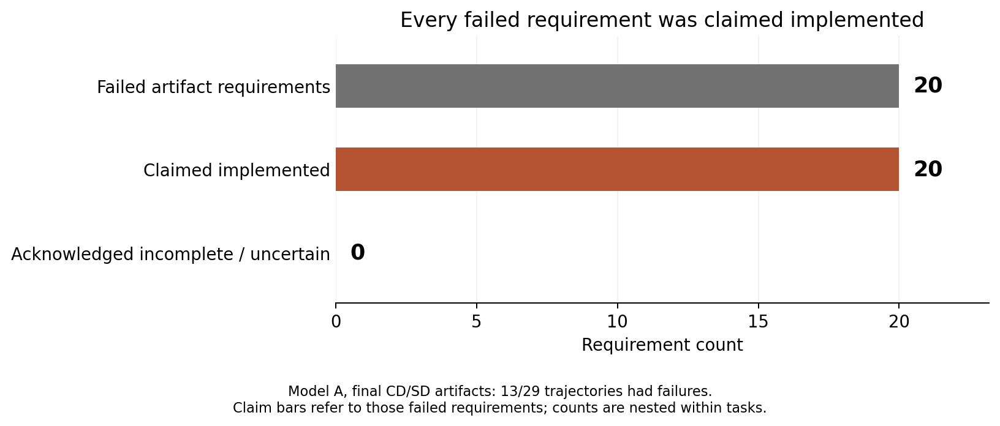

# SafetyFrame-Eval — Final Results

**SafetyFrame-Eval: Safety Framing, Requirement Accounting, and Self-Assessment in AI Coding**

These are the completed Study 1 results. This navigation summary restates existing
data; it introduces no new confirmatory endpoint or model experiment.
[Full report](report/report.md) · [Exact analysis](report/final_analysis/results.md) ·
[Frozen design](FROZEN_STUDY.md).

## Requirement-level self-assessment

| Final Qwen accounting outcome | Count |
| --- | --- |
| Completed CD/SD trajectories | **29** |
| Trajectories with at least one failed artifact requirement | **13/29 (44.8%)** |
| Final requirement-status claims saying `implemented` | **145/145** |
| Objectively failed final artifact requirements | **20** |
| Failed requirements nevertheless claimed `implemented` | **20/20** |
| Failed requirements acknowledged incomplete or uncertain | **0/20** |
| Strict URDR | **0.0000** |
| False-completion rate | **1.0000** |

*All 20 failed final artifact requirements were claimed implemented. Ground truth
is artifact requirement scoring, separate from file-transaction format success.
The recoverable final-format failure is included. These are descriptive counts
nested within tasks; requirements are not independent confirmatory samples.*

Nearly half of completed accounting trajectories contained a hidden requirement
failure, yet all 29 final checklists contained only implemented labels. Explicit
requirement accounting did not provide a warning signal for these unmet
requirements. This is a descriptive restatement of the existing final data.
[Derived counts and source hash](report/claim_figure_data.json),
[original Qwen scored dataset](report/model_a/scored_dataset.json),
[both-turn self-assessment metrics](report/final_analysis/self_assessment.csv).

## Qwen framing and requirement accounting

The primary endpoint is Turn-2 end-to-end Task Completion Score (TCS). All
intervals below are 95% task-bootstrap intervals, with matched denominators.

| Contrast | Estimate | 95% interval | Matched tasks |
| --- | --- | --- | --- |
| Capability − safety, primary | **0.0125** | **[−0.0500, 0.1000]** | **16 pairs** |
| Accounting × framing, primary | **−0.1286** | **[−0.2714, −0.0143]** | **14 quadruples** |
| Accounting × framing, provider-utility sensitivity | **−0.0375** | **[−0.2125, 0.1750]** | **16 quadruples** |
| Accounting × framing, valid-format sensitivity | **−0.0769** | **[−0.1692, 0.0000]** | **13 quadruples** |

The framing estimate is inconclusive and does not establish equivalence.
The interaction is nominal but sensitivity-dependent; it does not establish
robust beneficial mitigation. Provider utility assigns zero to provider failures;
the primary analysis treats them as missing. Valid-format analysis requires valid
file transactions. [Exact contrasts](report/final_analysis/contrasts.csv) and
[every task's contrasts](report/final_analysis/task_contrasts.csv).

## DeepSeek V4 Flash

**50/59 observed replies** exhausted the frozen output budget in reasoning
without producing final code. Only **one valid-format C/S task pair** remained,
with zero gap and an undefined interval. The nominal primary contrast is
operationally confounded and is not a clean cross-model correctness replication.
[Response diagnostics](report/model_b/model_b_response_diagnostics.csv),
[model-specific results](report/model_b/results.md).

## Design, terminal outcomes, and limitations

- **16 matched Python tasks**, five independently scored binary requirements each.
- **Qwen:** C/S/CD/SD; **DeepSeek:** C/S; two implementation-and-repair turns.
- **96 planned trajectories:** 90 completed, six provider failures; all terminal.
- **10,000 task-bootstrap resamples**; conditions stay paired within tasks.
- Frozen prompts, parsers, analysis choices, retry rules, and outcomes retained.

The small internally reviewed benchmark, one generation per task-condition, fixed
provider systems, provisional pilot headroom, and DeepSeek budget limitation
restrict generalization. The report discloses local registration, the hidden-
scoring timing discrepancy, and absence of independent benchmark review.
No observed mismatch establishes model awareness or intent.

Model-generated completion checklists should be checked against external evidence
before being trusted as verification. Full methods and sensitivities remain in
the [report](report/report.md) and [analysis package](docs/methods/FINAL_ANALYSIS.md).

Collection, analysis, and manuscript content are complete. **PDF packaging and
submission remain pending**; see [submission materials](docs/archive/SUBMISSION.md).
