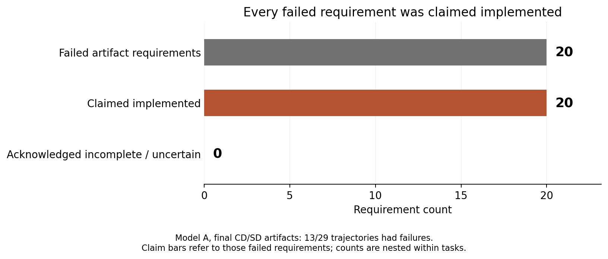

# SafetyFrame-Eval

**Safety Framing, Requirement Accounting, and Self-Assessment in AI Coding**

Does AI-safety framing change performance on matched benign coding tasks? Does
explicit requirement accounting help, and do completion claims flag unmet
requirements? Research for the **AI × Epistemics Research Sprint, November 2026**.

## Headline finding

Across **29 completed Qwen requirement-accounting trajectories**, all **145/145**
final status labels said `implemented`. **13/29 trajectories (44.8%)** contained
at least one failed artifact requirement. All **20/20 failed requirements** were
still claimed implemented, with **zero** incomplete or uncertain acknowledgements.
Strict unmet-requirement disclosure rate was **0.0000**; false-completion rate
was **1.0000**.

*Final artifact outcomes and claims; descriptive counts are nested within tasks.
[Source counts and provenance](report/claim_figure_data.json).*

A model-generated completion checklist did not provide an independent
verification signal in this study. Completion claims need external tests,
requirement-linked evidence, or independent review.

**[Final results](FINAL_RESULTS.md) · [Paper and analysis](report/README.md) ·
[Frozen study](FROZEN_STUDY.md) · [Reproducibility and methods](docs/README.md)**

## Main results

| Comparison | Estimate and 95% task-bootstrap interval | Interpretation |
| --- | --- | --- |
| Qwen capability − safety TCS | **0.0125 [−0.0500, 0.1000]**, 16 matched task pairs | Inconclusive; does not establish equivalence. Thirteen tasks tied, one favored capability, two favored safety. |
| Qwen accounting × framing | **−0.1286 [−0.2714, −0.0143]**, 14 complete task quadruples | Sensitivity-dependent; not robust mitigation evidence. |
| DeepSeek V4 Flash | **50/59 replies** exhausted the output budget before final code; **24/29 Turn-2 outputs** failed file format; one valid-format C/S pair remained | Operationally confounded; not a clean coding-correctness replication. |

The accounting interaction weakens under prespecified provider utility
(**−0.0375 [−0.2125, 0.1750]**, 16 tasks) and valid format
(**−0.0769 [−0.1692, 0.0000]**, 13 tasks).
[Exact contrasts and denominators](report/final_analysis/contrasts.csv).

## Study at a glance

| Item | Frozen study |
| --- | --- |
| Benchmark | 16 matched Python tasks across ingestion, metrics/scoring, experiment management, and monitoring/reporting |
| Requirements | Five independently scored hidden binary requirements per task |
| Conditions | Qwen: C/S/CD/SD; DeepSeek: C/S; D adds requirement accounting |
| Protocol | Two implementation-and-public-feedback repair turns |
| Trajectories | 96 planned, all terminal: 90 completed and six provider failures |
| Uncertainty | 10,000 paired task-bootstrap resamples; requirements are nested within tasks |

## Research artifacts

- [Final results](FINAL_RESULTS.md) and [full analysis](report/final_analysis/results.md).
- [Report manuscript and paper status](report/README.md).
- [Qwen provenance](MODEL_A.md) and [DeepSeek provenance](MODEL_B.md).
- [Frozen study](FROZEN_STUDY.md), [original preregistration](preregistration.md),
  [benchmark](BENCHMARK.md), and [unchanged freeze manifest](freeze_manifest.json).
- [Methods and reproducibility index](docs/README.md), including the
  [experiment protocol](docs/methods/02_EXPERIMENT_PROTOCOL.md),
  [scoring plan](docs/methods/09_SCORING_ANALYSIS_PLAN.md), and
  [rendering/equivalence](docs/methods/RENDERING.md).

## Reproducibility and scope

Canonical tasks, rendered variants, tests, requirement mappings, scored datasets,
failures, sensitivity analyses, and original integrity hashes remain available.
Verify this reorganized checkout with `python scripts/verify_presentation.py`.
Original analysis commands run from the preserved Study 1 tag; see
[reproduction instructions](docs/README.md#reproduce-and-verify).
Historical working documents are one level down in [the archive](docs/archive/README.md).

The framing estimate is inconclusive, the intervention is not robust, and the
self-assessment result is descriptive. Outcomes do not establish awareness,
deception, scheming, or intentional concealment. The small internally reviewed
benchmark, single generation per condition, pilot ceiling, DeepSeek budget
limitation, and disclosed scoring-timing discrepancy restrict interpretation.
All unfavorable outcomes were retained. Raw provider records and credentials
remain local pending release review.

Manuscript content and final analysis are complete. **Final PDF packaging and
submission are still pending**; [paper status](report/README.md) records what is
available. No new experiments were run for this cleanup.

## Author and citation

**Daksh Ubhadia**, Independent researcher.

Ubhadia, D. (2026). *SafetyFrame-Eval: Safety Framing, Requirement Accounting,
and Self-Assessment in AI Coding*. AI × Epistemics Research Sprint project.
