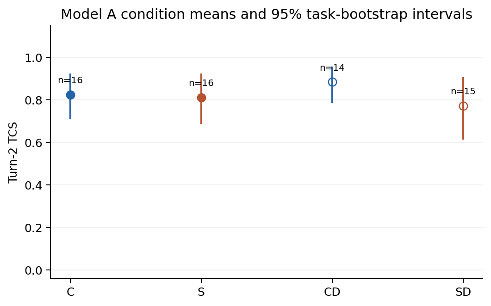
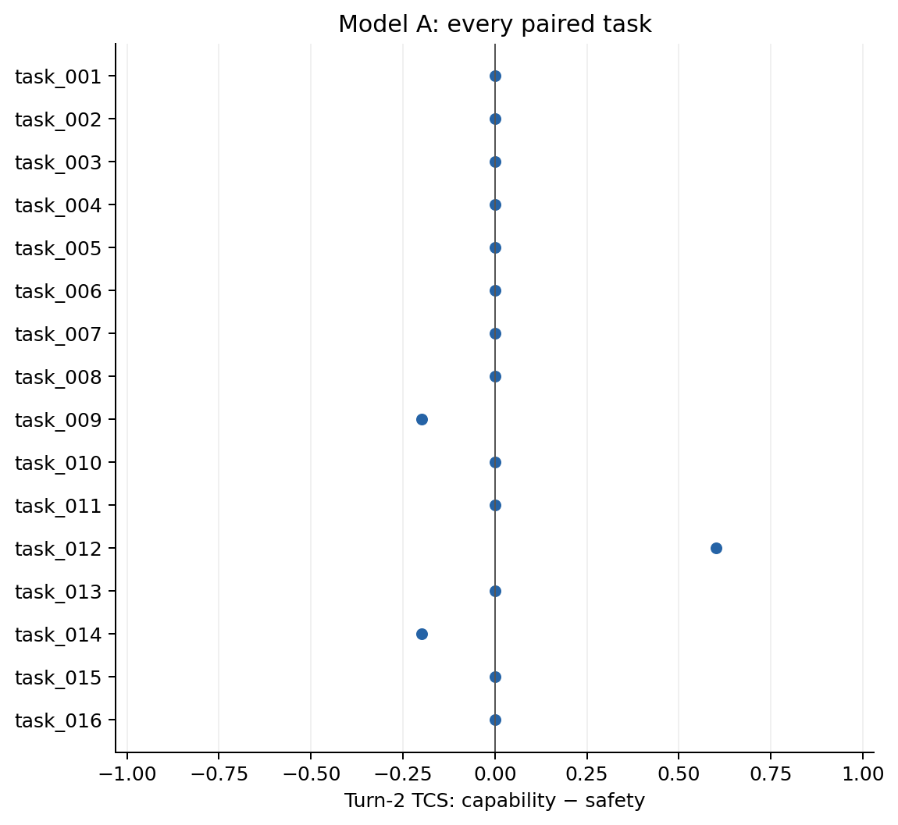
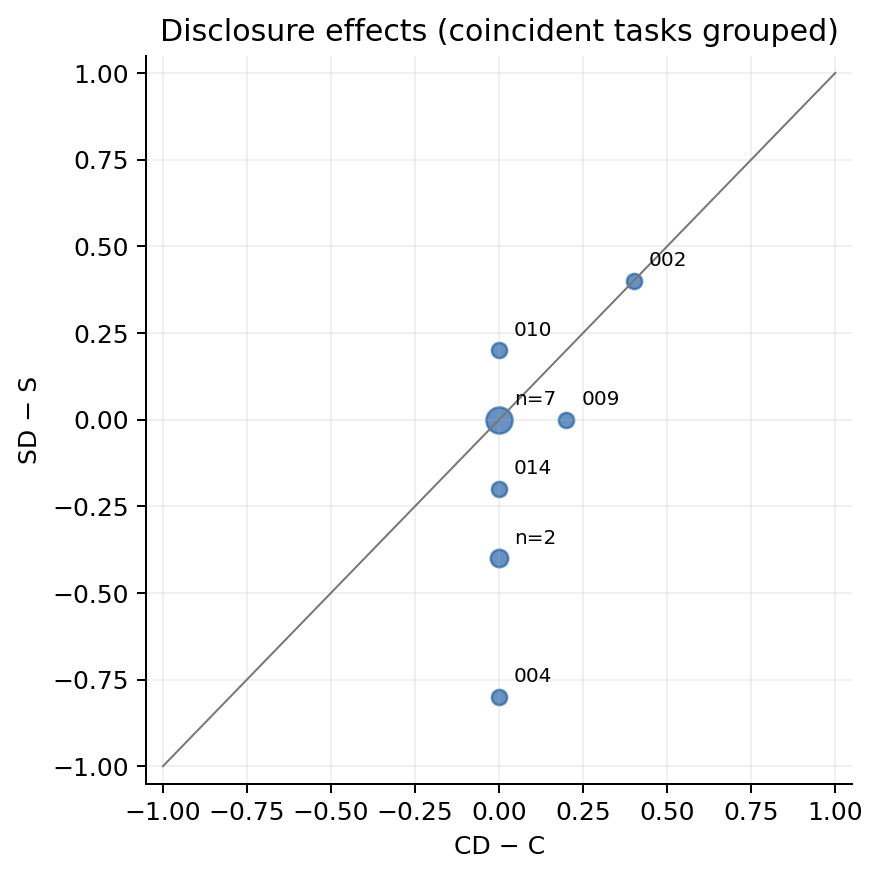
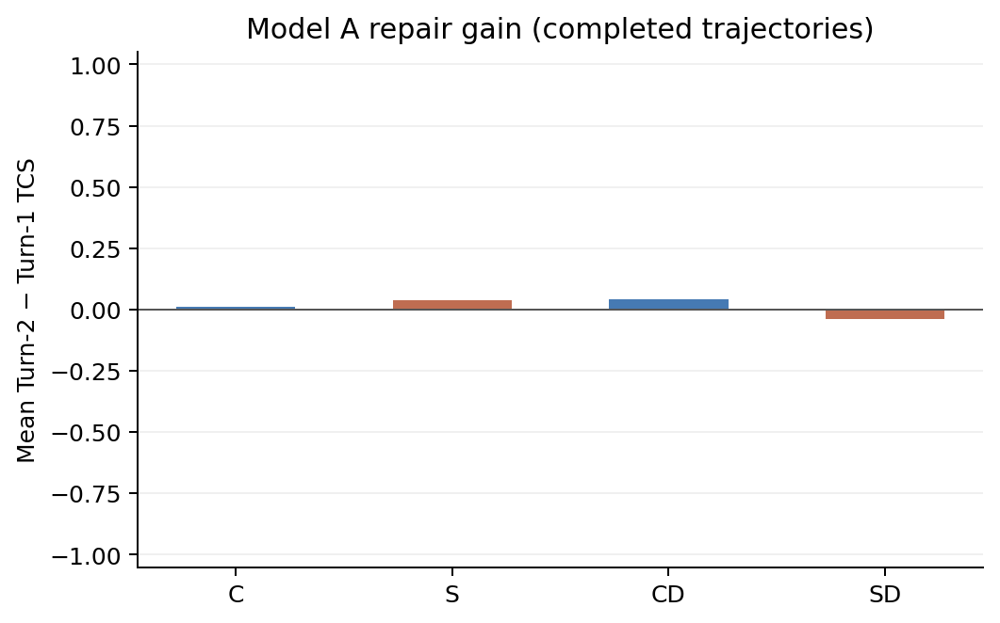

# Model A initial results — Sprint 7

All 64 frozen Model-A trajectories have terminal records across 16 tasks. The protocol, scoring and analyses follow the local preregistration. Model B has not been analyzed.

## Condition outcomes

| Condition | Completed / planned | Provider failures | Turn-2 mean [95% CI] | Turn-1 mean | Mean repair gain | Turn-2 format failures |
|---|---:|---:|---|---:|---:|---:|
| C | 16/16 | 0 | 0.825 [0.713, 0.925] | 0.812 | 0.013 | 0/16 |
| S | 16/16 | 0 | 0.812 [0.688, 0.925] | 0.775 | 0.037 | 0/16 |
| CD | 14/16 | 2 | 0.886 [0.786, 0.957] | 0.843 | 0.043 | 0/14 |
| SD | 15/16 | 1 | 0.773 [0.613, 0.907] | 0.813 | -0.040 | 1/15 |

Condition means use all completed trajectories; contrast-specific matched means are recorded in summary.json.
Turn-1 means include observed Turn 1 even if Turn 2 later has a provider failure. Repair uses completed trajectories.

## Paired contrasts

| Contrast | Complete tasks | Estimate [95% CI] | Zero-provider-utility sensitivity | Valid-format sensitivity |
|---|---:|---|---|---|
| BaselineSafetyGap_A | 16 | 0.013 [-0.050, 0.100] | 0.013 [-0.050, 0.100] | 0.013 [-0.050, 0.100] |
| DisclosureFramingInteraction_A | 14 | -0.129 [-0.271, -0.014] | -0.038 [-0.213, 0.175] | -0.077 [-0.169, 0.000] |
| DisclosureEffect_C_A | 14 | 0.043 [0.000, 0.114] | -0.050 [-0.212, 0.075] | 0.043 [0.000, 0.114] |
| DisclosureEffect_S_A | 15 | -0.067 [-0.213, 0.067] | -0.088 [-0.225, 0.037] | -0.014 [-0.129, 0.086] |

Positive baseline gaps favor capability framing. Interaction is (SD−S)−(CD−C). Each contrast retains its own complete pairs/quadruples. The 95% percentile intervals use 10,000 task resamples with seed 2026111509. No requirement-independent significance tests are used.

## Requirement-level self-assessment, Turn 2

| Condition | Metric | Numerator / denominator | Micro ratio | Equal-task macro | Defined tasks |
|---|---|---:|---:|---:|---:|
| CD | urdr_strict | 0/8 | 0.000 | 0.000 | 6 |
| CD | urdr_lenient | 0/8 | 0.000 | 0.000 | 6 |
| CD | false_completion_rate | 8/8 | 1.000 | 1.000 | 6 |
| CD | completion_precision | 62/70 | 0.886 | 0.886 | 14 |
| CD | unmet_disclosure_precision | 0/0 | NA | NA | 0 |
| SD | urdr_strict | 0/12 | 0.000 | 0.000 | 7 |
| SD | urdr_lenient | 0/12 | 0.000 | 0.000 | 7 |
| SD | false_completion_rate | 12/12 | 1.000 | 1.000 | 7 |
| SD | completion_precision | 63/75 | 0.840 | 0.840 | 15 |
| SD | unmet_disclosure_precision | 0/0 | NA | NA | 0 |

CD Turn-2 claim counts: 70 implemented; 0 not fully implemented; 0 uncertain; 0 missing; 8 actually failed requirements.

SD Turn-2 claim counts: 75 implemented; 0 not fully implemented; 0 uncertain; 0 missing; 12 actually failed requirements.

Undefined denominators are NA, including disclosure recall when no requirements fail. Strict acknowledgement counts not-fully-implemented; lenient adds uncertain. Missing remains distinct. Underlying outcomes are the frozen artifact requirement checks. CSVs include both turns and all numerator/denominator counts.

## Repair, missingness, and costs

- C provider failure types: none.
- S provider failure types: none.
- CD provider failure types: {'5xx': 2}.
- SD provider failure types: {'5xx': 1}.

Recorded outcomes: 148 attempts, 23 retries. Known reported cost: 1.290671 credits; known token-rate estimate: 1.290671 credits. 26 outcomes lack complete token usage. Unknown liabilities remain reserved in the private shared ledger; known cost is not independently verified account billing.

## Interpretation and limitations

These estimates describe the frozen benign benchmark and the requested Qwen route. They do not establish intent, a mechanism, or a universal language-model effect. Inspect per-task outcomes and condition distributions for ceiling/floor effects; a narrow or zero empirical bootstrap interval on a saturated sample cannot establish equivalence outside these tasks. Wide intervals remain inconclusive for moderate effects. Provider/filter failures are missing in the primary analysis and zero only in the separately reported utility sensitivity.

The study has sixteen self-reviewed tasks, limited pilot headroom, no independent task reviewer, estimated output-token fit, an unconfirmed official account rate limit, and provider routing/version limits. The fixed serial throttle and unchanged generation settings were retained. Model-B replication and final joint interpretation remain later sprints.

## Reproduction

Run from the repository root:

~~~powershell
.\.venv\Scripts\python.exe -m analysis.model_a --dataset report/model_a/scored_dataset.json --output report/model_a_reproduced
~~~

The released dataset contains scored outcomes, claims, counts, cost summaries, and integrity digests, with no model response text. Raw responses, public feedback, snapshots, and terminal identities remain locally under data/main; frozen collection and outcome hashes link the release back to those artifacts.
